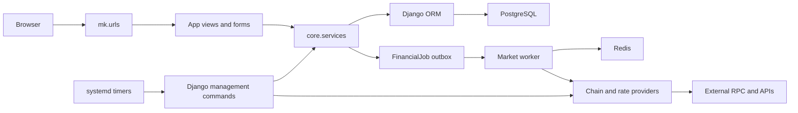

# Kola Market architecture

## System overview

Kola is a server-rendered Django application. PostgreSQL is the source of truth for accounts, catalog, orders, append-only ledger entries, payment events, reviews, notifications, and operational records. Redis supports authentication throttling and asynchronous financial jobs. Workers and scheduled management commands communicate with external chain and rate providers through provider adapters.

## Domain apps and data

- `accounts`: custom user, PGP challenge authentication, sessions, profile.
- `catalog`: vendor profiles, categories, listings, image uploads, reviews, listing rating aggregates.
- `orders`: delivery zones, orders and state machine, disputes, evidence, public rulings, and emergency transition audit records.
- `ledger`: accounts and immutable signed entries; balances are aggregated from entries.
- `payments`: deposit addresses/events, exchange-rate quotes, payout addresses, withdrawals, provider watermarks, and Monero escrow integration state.
- `core`: shared notification and financial-job models, business services, context processors, and notification routes.
- `ops`: global market switches, staff operations dashboards, and reserve integrity/snapshots.

Important relationships: a vendor profile belongs to one user; listings belong to a vendor and category; an order belongs to a buyer, vendor, and listing; each review references one finalized order; disputes and public rulings are one-to-one with an order/dispute respectively; payment records reference their user/address/order; ledger entries reference an account and optionally an order. Foreign-key behavior and constraints are defined in app models and migrations.

## Request and service boundaries

1. `mk/urls.py` composes app URL configurations.
2. Views enforce request methods, authentication, staff/participant access, and form validation.
3. Business state changes are delegated to `core/services/`, generally inside database transactions with row locks.
4. Models and migrations define persisted state and database constraints.
5. Templates render server-side pages; there is no frontend framework or client-side state bundle.

Financial jobs are written to `core.FinancialJob` as part of the business transaction. An `on_commit` callback publishes the job to Redis; the worker claims jobs atomically using PostgreSQL row locks and `SKIP LOCKED`, then invokes the appropriate provider/service. This keeps jobs durable across queue delivery failures.

## Security boundaries

PGP verification uses a local GnuPG subprocess. Application passwords are hashed with Argon2; recovery codes are single-use hashes. Sensitive shipping fields are encrypted at rest. Evidence files are served through authorized views. Provider adapters isolate external calls. Monero multisig signing is delegated to an independently operated signer gateway; Kola does not hold participant signing keys. The external gateway remains a deployment dependency and must independently enforce participant authorization.

Staff-only surfaces include Django admin, vendor/listing moderation, order management/overrides, withdrawal review, and operations controls. Emergency order changes must preserve an audit trail including actor, timestamp, prior state, target state, and reason.

## Operational architecture

`deploy/systemd/` contains web, worker, scheduler, watcher, reserve, monitoring, and backup units/timers. Health checks cover configured service dependencies; detailed deployment assumptions and restoration steps are in [`OPERATIONS.md`](OPERATIONS.md) and [`BACKUP.md`](BACKUP.md). Backup encryption keys and remote destinations are deployment-managed secrets and are not stored in the repository.

## Evidence

- [`mk/urls.py`](../mk/urls.py), [`catalog/views.py`](../catalog/views.py), [`orders/views.py`](../orders/views.py) — request routing and page actions.
- [`core/services/`](../core/services/) — transactions, domain operations, and queue/outbox boundary.
- [`accounts/models.py`](../accounts/models.py), [`catalog/models.py`](../catalog/models.py), [`orders/models.py`](../orders/models.py), [`payments/models.py`](../payments/models.py), [`ledger/models.py`](../ledger/models.py), [`core/models.py`](../core/models.py), [`ops/models.py`](../ops/models.py) — schema and relationships.
- [`payments/providers/`](../payments/providers/) — provider adapters.
- [`deploy/systemd/`](../deploy/systemd/) — service and timer definitions.
- [`docs/MONERO_MULTISIG_ESCROW.md`](MONERO_MULTISIG_ESCROW.md) — external signer gateway contract.
